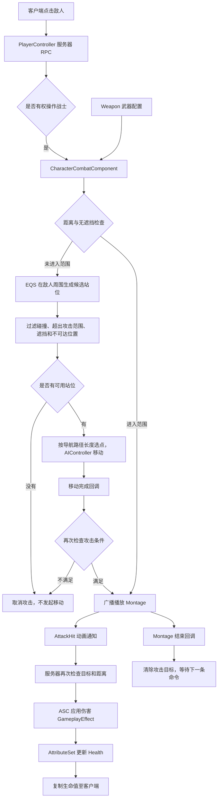

# 普通攻击实现

## 操作

打开 TestMap，PIE 后点击自己的战士，再点击蘑菇。角色由 AI 寻路接近，在距离和无遮挡检查通过后只播放一次攻击。每条命令依次选用劈砍、横斩、突刺，动作结束后不会自动继续；再次点击敌人才发动下一刀。点击地面取消攻击并移动。小怪目前不反击。

寻路历次方案见 [PathfindingIterations.md](PathfindingIterations.md)；动画蓝图、蘑菇受击/死亡与血条见 [AnimationAndHealthUI.md](AnimationAndHealthUI.md)。目前普攻生命周期由 [Gameplay Ability](BasicAttackGameplayAbility.md) 管理；下文架构与早期验证记录按当时版本保留。

## 职责

- BoldersPlayerController：本地点击分类，ServerRequestAttack 校验 Attacker == AssignedCharacter。
- CharacterCombatComponent：保存攻击意图、武器、Montage 和命中时机，向站位组件请求到位，再通过完成回调继续攻击。
- AttackPositioningComponent：服务器上的站位任务，管理一次 EQS 查询及其导航移动；取消时只中止本组件的请求。
- AttackPositionRules：无状态的距离、视线、胶囊空间及路径避让目标规则，供选点和实际命中复核共用。
- AttackTargetContext：从查询发起者（战士）的站位组件取得本次请求的目标。
- EnvQueryTest_AttackPosition：检查候选点的攻击距离、角色胶囊体容纳空间与目标间遮挡。
- EnvQueryTest_AttackPath：每个候选点只做一次寻路，过滤不完整路径及穿过目标身体的路径，并以路径长度评分。
- BoldersAIController / CharacterMovement：导航路径与实际角色移动。
- Weapon：武器模型、挂点、伤害、攻击范围与 Montage 列表。服务器生成并附着，复制到客户端。
- AnimNotify_AttackHit：Montage 命中时刻通知战斗组件；客户端通知不会扣血。
- BaseCharacter：阵营、ASC 生命周期、受伤入口与零血停止移动。
- BoldersDamageEffect：即时修改 Health，SetByCaller 传入负的伤害值。
- BoldersAttributeSet：生命值、最大生命值、合法范围与属性复制。

## 资产

- `/Game/BoldersDemo/Assets/Combat/EQS_FindAttackPosition`，在 BP_Warrior 的 Combat 组件上配置。
- `/Game/BoldersDemo/Assets/Characters/Warrior/Animations/Montages/AM_Warrior_Chop`
- 同目录 `AM_Warrior_Slice_Horizontal`、`AM_Warrior_Stab`
- `/Game/BoldersDemo/Blueprints/Combat/Weapons/BP_WarriorSword`
- `/Game/BoldersDemo/Blueprints/Characters/Enemy/BP_EnemyMushroom`
- ABP_Warrior：Locomotion 输出经过 DefaultSlot 再连接最终姿势。

旧 KayKitEquipmentComponent 源码已移除，删除前工作区版本备份在 Saved/CombatImplementation/Backup。新 Weapon 使用显式蓝图配置，不再根据角色模型路径猜装备。原来弓弦及双手装备自动切换逻辑不再存在。

## EQS 配置与行为边界

Donut 在攻击目标周围生成 2 圈，每圈 12 个候选点，并投影到导航网格。运行时半径由武器攻击距离和双方胶囊半径计算，向内留出 25～40 单位余量。AttackPosition 测试过滤攻击距离不符、站不下胶囊体及攻击方向受阻的点；AttackPath 从 Querier（战士）到候选点查询完整路径，过滤不可达点，以及距离目标不足双方胶囊半径之和加 10 单位的路径线段，优先选择剩余路径较短者。到达容差为 10 单位。SingleResult 返回一个结果。

EQS 只选目的地；AIController 和 CharacterMovement 仍负责沿导航路径移动。查询、移动和扣血都由服务器执行，客户端仍从 PlayerController 发送攻击 RPC。取消命令先清理请求 ID，再中止查询、移动和动画，避免过期回调继续攻击。站位组件记录实际订阅的 PathFollowingComponent，并在完成、取消、EndPlay 时解除绑定。战斗组件保留原有 EQS 资产属性，以兼容现有蓝图配置。

这是有限采样，不保证找到所有几何上可能的攻击点。没有结果时不移动；到达时目标移出范围则取消，当前不自动重新查询。路径避让目标采用平面距离保守过滤，不自动生成绕目标的额外绕行路径；没有合格路径时可能拒绝本来可以通过更复杂绕行到达的站位。目标移动后的回合事件重规划、多角色站位预留和行动点预算尚未加入。

## 职责拆分与目标避让验证（2026-11-17）

### 攻击接近的提前完成（2026-11-17）

后续针对接近途中整体侧移做了 RVO 对照：同一路径、同一个 EQS 点，500 范围下末段从 (594,-343) 偏到 (624,-300)，150 范围和关闭 RVO 的末段均到 (638,-314)。这说明该案例的额外末段转向与 RVO 有关；前面的绕障路径仍存在，不应把所有拐弯都归因于 RVO。将 BaseCharacter 默认 AvoidanceConsiderationRadius 设为 150，同时保存 Warrior、EnemyMushroom 蓝图及地图实例。保留 RVO、原胶囊尺寸和碰撞。重新编译、重开编辑器后，两名战士和两只蘑菇的运行值均为 150。150 是当前小胶囊、低数量 demo 的调参，不是通用的人群参数。证据 Saved/OuterApproach/Compare.json、PIE.log。

原先必须进入 EQS 坐标的 10 单位容差才攻击，RVO 导致偏离后，即使已经能攻击也会继续回绕。现在只在攻击寻路期间绑定 Character 的 OnCharacterMovementUpdated：服务器确认当前移动请求仍属于本组件、双方存活、角色在地面，且当前距离和视线满足攻击条件，就结束自己的移动请求并通知 Combat。停止范围向内留 5 单位余量；取消移动先解绑监听，再 AbortMove 清速度，最后调用战斗回调。正常到达 EQS 点仍可完成，Combat 会再次检查攻击条件。

没有增加常驻 Tick、定时查询或更换 RVO。移动更新期间仍会执行条件检查；距离不满足时不会做视线检测。该修改解决攻击接近阶段的回绕，不代表已解决任意动态人群的拥堵。

参考 Epic [EQS Quick Start](https://dev.epicgames.com/documentation/unreal-engine/environment-query-system-quick-start-in-unreal-engine) 中攻击与移动分支的切换思想，以及 [OnCharacterMovementUpdated](https://dev.epicgames.com/documentation/unreal-engine/BlueprintAPI/Character/OnCharacterMovementUpdated) 移动更新事件。当前项目保留组件结构，没有为了这次修复引入行为树。

Editor Development 编译通过。双人 PIE 重放先前回绕路线，RVO 保持启用：EQS 点 (638.28,-314.50)，实际在 (623.56,-299.54,91.65)、距目标 137.26 时停止并播放 Montage；采样中开始攻击后位置偏移为 0，目标生命由 100 降至 0。客户端取消攻击后执行新的地面移动、无站位不移动两项回归也通过，目标保持 100 血。证据 Saved/ApproachFix/Check.json、EdgeCases.json、PIE.log。后台编辑器采样频率较低，此记录用于检查轨迹与状态，不用于性能比较。临时测试位置仅在 PIE 世界修改，测试结束已停止 PIE。

- Editor Development 编译和链接成功，BP_Warrior 编译、保存，EQS 资产更新为 AttackPosition + AttackPath 两项测试。
- 双人 PIE，客户端攻击 RPC：从 (0,250)、(1200,450)、(850,850) 三个起点接近同一目标，均完成导航并命中，分别约 4.7、3.0、3.3 秒。最终中心距离约 154～159 单位。
- 攻击移动途中取消，以及目标位于导航投影范围之外的分支通过；无站位时角色保持原位置，目标没有扣血。
- 证据：Saved/EQSRefactor/Approaches.json、EdgeCases.json、PIE.log。临时位置仅修改 PIE 世界，未写回地图。此次未做 Cook/打包和动态人群阻挡的全面验证。

## 初版 EQS 验证记录（2026-11-17）

- Editor Development 编译、链接通过，查询资产保存并绑定 BP_Warrior 的 Combat 组件，EQS 编辑器图可打开。
- 双人 listen-server PIE，以 Python 调用客户端 PlayerController 的真实 ServerRequestAttack RPC：服务器选择 (697,450) 站位，角色到位后五次伤害将敌人生命值由 100 降到 0，两端位置和生命值一致。
- 攻击移动途中通过客户端 ServerRequestMove 取消攻击：目标仍为 100 血，战士执行新移动命令。
- 仅在 PIE 临时把目标移到导航范围外：查询返回无站位，战士位置不变、目标仍为 100 血；停止 PIE 后临时修改消失。
- 证据：Saved/EQSImplementation/PIE.log、Runtime.json、EdgeCases.json。定向测试走真实网络 RPC，但此次没有重新覆盖鼠标点击分类。未做大规模单位性能基准、Cook 或打包验证。

## 旧版定时追击的验证记录

- Editor Development 编译和链接成功。
- 三个 Montage 已保存，ABP 编译成功。
- 两玩家 listen-server PIE：真实鼠标点击客户端 2P 战士与敌人，绕墙接近后五次伤害将 Health 从 100 降到 0。两端数值一致，武器 Actor 在两端均附着到正确战士。
- 再点击另一敌人后点击地面：追击被中止，移动成功，另一个敌人仍为 100 血。
- 证据：Saved/CombatImplementation/FirstClickAndCancel.log、FirstClickResult.json。

当时已在运行角色上检查三个 Montage 的命中附近姿势和武器挂接。原始命中通知统一放在 45%；后续按动作采样调整为劈砍 56%（约 0.597 秒）、横斩 18%（约 0.246 秒）、突刺 30%（约 0.480 秒）。这些是动画时点，使用距离和遮挡检查，不进行剑刃逐帧碰撞。非致命受击 Montage 由服务器确认扣血后广播播放，死亡使用死亡动画分支，没有额外的受击 AnimNotify。双人 PIE 中每次命令仍只扣一次血，两端数值一致并捕获受击 Montage；实际视觉对齐受角色距离、朝向、帧率和网络延迟影响。
