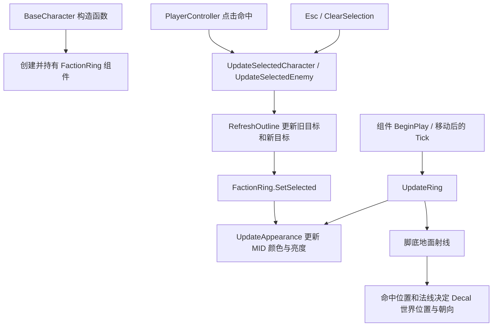

# 角色脚底阵营圆环

## 使用与配置

我方角色显示蓝环，敌方显示红环。选中时提高亮度，取消选择恢复基础亮度；悬浮描边仍是独立反馈。中立、死亡、隐藏角色，以及脚下检测不到近处地面的角色不显示圆环。

点击我方角色保留原来的指令选择；点击地面移动不会取消我方选择。点击怪物会选中怪物，若已选我方角色则仍发出攻击请求。Esc 或本地控制器的 `ClearSelection()` 清除双方视觉选择，但不会撤销已下达的移动或攻击命令。PIE 中 Esc 默认也可能被编辑器用于退出游戏，测试取消可在独立运行窗口中使用，或由 UI 调用 `ClearSelection()`。

打开 `BP_Warrior` 或 `BP_EnemyMushroom`，选中继承的 **FactionRing** 组件：

| 配置 | 默认值 / 作用 |
| --- | --- |
| Decal Material | `/Game/BoldersDemo/Assets/Shared/Materials/M_FactionRing` |
| Player Color / Enemy Color | 蓝色 / 红色 |
| Normal Brightness / Selected Brightness | 0.7 / 3.0 |
| Radius | 当前战士/小怪蓝图配置 100 cm（C++ 默认 55 cm），让圆环露出模型脚部；这是投射盒的平面半宽，材质外沿位于 UV 半径 0.44 |
| Projection Depth | 24 cm，投射盒沿地面法线的半深度 |
| Trace Above Feet / Below Feet | 从脚底上方 40 cm 向下检测至脚底下方 160 cm |
| Surface Offset | 沿地面法线抬高 1 cm |
| Stationary Trace Interval | 0.2 秒，仅对静止在固定地面的角色降低检测频率；移动或可移动地面每帧检测 |

材质是程序化空心圆环，无额外纹理。基础颜色负责在明亮地面上保持阵营色，Emissive 负责亮度变化。C++ 与材质之间约定两个参数名：向量 `RingColor` 和标量 `RingBrightness`。替换材质时保留这些名字并使用 Deferred Decal 域。圆环宽度目前由材质中的 0.39 / 0.44 内外 UV 半径控制。

## 代码职责与调用关系

- **ABaseCharacter**：继续作为阵营、生命和组件所有权的来源。新增 `GetFaction()` 只读访问器，以及通过 `CreateDefaultSubobject` 创建的 `FactionRing`。原角色 Actor Tick 仍关闭。
- **UFactionRingComponent**：继承 `UDecalComponent`，独立负责圆环表现。`BeginPlay()` 在专用服务器关闭 Tick，在客户端建立移动组件的 Tick 依赖。`UpdateRing()` 在 PostPhysics 阶段读取角色脚底位置、检测地面、调整 Decal，并决定是否可见。
- **UpdateAppearance()**：首次有材质时创建该组件专用的动态材质实例，以 `UPROPERTY(Transient)` 持有，避免 GC 问题。阵营或选中亮度改变时才写入材质参数，不每帧创建 MID。
- **ABoldersPlayerController**：继续保存真正的选择状态。新增 `UpdateSelectedCharacter()` 统一我方选择入口，已有 `UpdateSelectedEnemy()` 管怪物；`RefreshOutline()` 同时刷新原描边与圆环高亮。重新分配、死亡、切换目标及退出控制器时恢复旧目标状态。

圆环不复制选中状态，不增加 RPC；客户端使用原有复制的 Faction、Health 和角色位置独立计算。服务端控制权、寻路、GAS 和伤害逻辑保持原有职责。组件内的选中布尔值只是本地显示缓存，不负责授权。当前与原描边一样面向每个进程一个本地视角，未实现同一世界分屏玩家分别看到不同高亮。

## 地形处理与边界

地面查询只包含 WorldStatic / WorldDynamic，忽略自身胶囊与通常属于 Pawn 的其他角色。脚底来自胶囊中心减去缩放后的半高。用命中法线的反方向作为 Decal 局部 X 投射方向，因此可以贴合斜坡。组件使用绝对世界位置、旋转和缩放，不会随角色转身或模型缩放意外扭转、放大。

静止检测优化保留组件每帧 Tick，仅在角色脚底和固定地面均未变化时复用地面结果，默认每 0.2 秒复查。地面为可移动组件、正在下落、位置变化或缓存失效时仍逐帧检测，选中和死亡反馈不受检测间隔影响。优化示例见 [我做的角色圆环地面检测优化](../优化/角色圆环地面检测优化.md)。

这是投射贴花，不是按地形生成的网格。小台阶和起伏在投射盒深度范围内可以接收圆环；大落差边缘可能出现断环，垂直侧面、透明表面、关闭 Receives Decals 或没有对应地面碰撞的物体不保证显示。浅投射范围用于减少穿到下层或附近墙面的情况，不能保证所有复杂重叠几何都不串色。

资产生成入口：`Scripts/Editor/setup_faction_ring.py`。只给现有 BaseCharacter 子蓝图配置组件材质，普通 Actor 预览蓝图不强制改父类。修改前战士、小怪蓝图备份在 `Saved/FactionRing/`。

## 验证（2026-11-17）

- Development Editor 构建通过。
- `BoldersDemo.Presentation.FactionRing` 与原 `MonsterOutline` 自动化测试通过。覆盖每角色独立 MID、蓝红参数、选择与取消、平地、20 度斜坡、高台、移动、无地面、死亡及中立隐藏。
- 独立进程读取确认角色蓝图保存了贴花材质。最终蓝图尺寸为实测后调整的 100 cm。
- TestMap 的 Client 1 窗口实测蓝/红圆环显示、点击我方和怪物选中、取消与移动跟随。运行时记录确认客户端选中亮度为 3.0，服务器对应角色仍为 0.7，体现本地选择隔离。
- 当前 PIE 的 Esc 由编辑器用于结束预览；取消选择通过同一 `ClearSelection()` 入口实测。未做打包或专用服务器进程验收，也未对复杂连续崎岖地形作逐帧视觉验收。
- 日志和运行记录：`Saved/FactionRing/StateTests.log`、`Tests.log`、`RuntimeSelection.txt`、`RuntimeEnemySelection.txt`、`RuntimeMovement.txt`。测试已结束，编辑器保持打开。
- 收尾时在远程命令回调中关闭临时 Python 连接触发了 PythonScriptPlugin 访问异常。此前 PIE 已正常结束，日志确认内容资产无未保存项；故障日志保留在 `Saved/FactionRing/EditorValidation.log`。重新正常启动编辑器，不再次在活动回调内关闭连接。测试过程没有保存运行时角色位置到地图。
