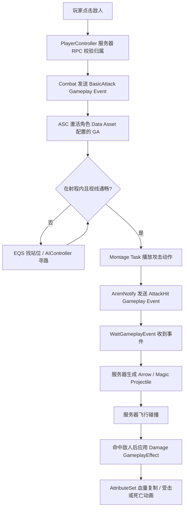

# 弓箭手、法师与共享投射物

## 开局职业配置

打开 `/Game/BoldersDemo/Blueprints/Shared/BP_BoldersGameMode`，在 Class Defaults 的 Characters 下编辑 `Starting Character Classes`。

- 数组第 0 项对应第一个玩家出生槽位，第 1 项对应第二个。
- 当前演示配置为 `BP_Archer`、`BP_Mage`，可替换为 `BP_Warrior`。
- 未配置的槽位使用原有 `Warrior Class`。出生槽位仍使用地图的 `WarriorSpawn` 标签。
- 这属于运行前的服务器配置，没有新增大厅选职业界面。每个玩家仍只有一个 AssignedCharacter，PlayerController 仍 Possess CameraPawn，战斗角色由 AIController 控制。

## 代码职责

`AArcherCharacter`、`AMageCharacter` 继承 `ABaseCharacter`。移动、阵营、ASC、生命属性和受击处理使用原有实现；外观和技能通过各自的蓝图和数据资产配置。

`AAttackProjectile` 是弓箭和魔法弹的共同父类。球体碰撞组件作为根组件，`UProjectileMovementComponent` 在服务器上推进并进行扫掠碰撞。客户端关闭本地投射物移动组件和碰撞，显示服务器复制的位置。命中后只由服务器调用原有 `ReceiveDamageFrom`，通过 GameplayEffect 修改 AttributeSet，然后销毁投射物；未命中的投射物五秒后销毁。

`BP_ArrowProjectile` 与 `BP_MagicProjectile` 都继承该父类，配置模型、材质、速度。箭模型原始尖端沿 +Y，蓝图将其转到飞行的 +X，并使箭尖对齐碰撞中心。魔法弹是无光照蓝色发光材质球。

`AWeapon::ProjectileClass` 为空时保持原来的近战结算；非空时在动画事件处生成对应投射物。武器还配置伤害、射程、Montage 和发射位置偏移。偏移以角色中心与朝向为基准，可在武器蓝图调整。

`ABowWeapon` 只处理弓弦表现：读取动画中的 `BowDraw` 曲线，弓弦中点随右手拉动。这个表现 Tick 不执行攻击判断或造成伤害。

## 普攻流程

上图的再次检查是寻路完成后的检查，不是无限重试循环；无法取得有效站位或目标失效时，本次攻击结束。

Ability 的授予仍发生在服务器初始化 ASC 后。`DA_ArcherAbilities` 和 `DA_MageAbilities` 分别引用 `GA_ArcherBasicAttack` 与 `GA_MageBasicAttack`，两者共用 `UBasicAttackAbility`，保持一次点击一次攻击。

发射前取消 Ability 不会产生投射物；已经发射的弹独立飞行，Montage 完成或玩家之后移动不会删除它。当前是直线射击，不追踪目标，移动中的敌人可以躲开。碰到友军会停止但不造成友伤。沿用原伤害接口规则：发射者已经死亡或失效时，不再造成伤害。

## 资产位置与初始数值

| 内容 | 弓箭手 | 法师 |
| --- | --- | --- |
| 角色蓝图 | `Blueprints/Characters/Archer/BP_Archer` | `Blueprints/Characters/Mage/BP_Mage` |
| 动画蓝图 | `ABP_Archer` | `ABP_Mage` |
| 技能蓝图 | `Blueprints/Abilities/GA_ArcherBasicAttack` | `Blueprints/Abilities/GA_MageBasicAttack` |
| 技能数据 | `Assets/Combat/DA_ArcherAbilities` | `Assets/Combat/DA_MageAbilities` |
| 武器蓝图 | `Blueprints/Combat/Weapons/BP_ArcherWeapon` | `Blueprints/Combat/Weapons/BP_MageWeapon` |
| 投射物蓝图 | `Blueprints/Combat/Projectiles/BP_ArrowProjectile` | `Blueprints/Combat/Projectiles/BP_MagicProjectile` |
| 伤害 / 射程 | 20 / 750 cm | 25 / 650 cm |
| 飞行速度 | 1200 cm/s | 900 cm/s |

以上资产路径均相对于 `/Game/BoldersDemo/`。射程沿用胶囊表面之间的距离定义，角色中心之间的允许距离还包括双方胶囊半径。

动画蓝图包含速度驱动移动、DefaultSlot 攻击/受击和非循环死亡动作。弓箭攻击 Montage 连接 Draw 与 Release，通知在约 1.467 秒；法师 Shoot 通知在约 0.373 秒。这些通知时间可继续在 Montage 编辑器内调整。

## 维护

`Bolders.BuildRangedAnimation` 创建缺失的动画资产，已有攻击 Montage 保留美术调整的通知时间。`Scripts/Editor/setup_ranged_characters.py` 配置角色、武器、技能与演示职业；重新运行会重新应用脚本中的默认数值和职业数组。

## 本次验证

- UE 5.9 Development Editor 编译通过。
- 双人 PIE：服务器弓箭手和客户端法师分别通过 PlayerController 发起攻击，各扣一次 20 / 25 血；客户端记录到 Montage、飞行投射物与同步后的血量。见 `Saved/RangedCharacters/combat.json`。
- 拒绝其他玩家控制角色、发射前移动取消、发射后墙体拦截、超射程 EQS 接近、进入远程攻击范围后停步均通过，见 `Saved/RangedCharacters/edge_tests.json`。
- 客户端实际鼠标选择法师、点击蘑菇，观察到血条由 75 降至 50；也检查了两种角色最终游戏画面。
- 重新打开编辑器后，角色、动画、挂点、Data Asset、GA、投射物与开局职业引用检查通过，见 `Saved/RangedCharacters/reopened_assets.json`。
- 未进行 Cook/打包和高网络延迟下的视觉平滑验收。
