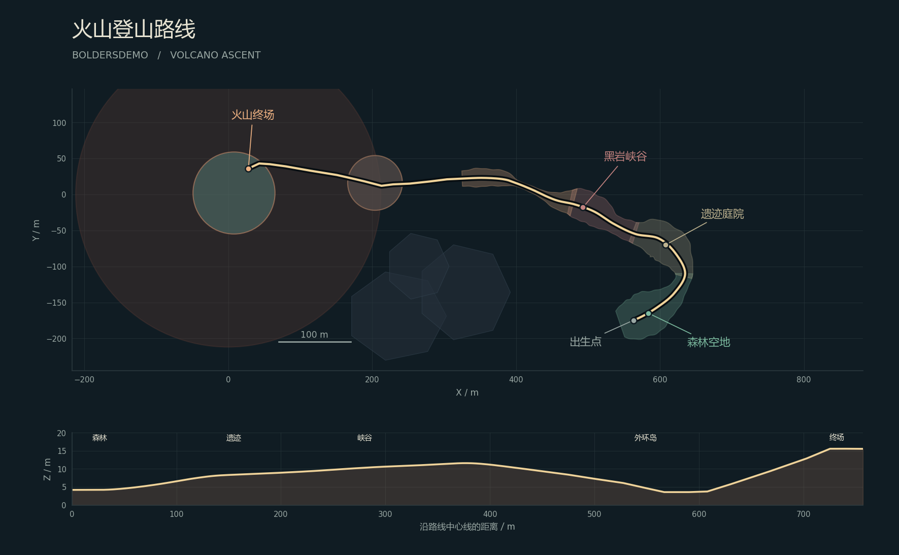

# 火山登山地图

在内容浏览器打开 `/Game/BoldersDemo/Assets/Maps/L_VolcanoAscent`，点击 Play 并选择职业。森林入口有两个角色出生点。现有的点击移动、平移、旋转和缩放适用于整条路线。

| 场地 | 从哪里进入 | 去往哪里 |
| --- | --- | --- |
| 森林空地 | 山脚出生点 | 顺浅色林间小道走上山脊 |
| 遗迹庭院 | 山脊转弯后的断墙 | 穿过庭院石板，在两座残塔之间下到岩谷入口 |
| 黑岩峡谷 | 裸岩坡道 | 横穿岩棚和高桥，经东侧山隘走向熔岩盆地 |
| 火山终场 | 熔岩外环岛 | 走火山桥抵达原图的核心石台 |

本图提供四处空场地、碰撞和 Recast 导航，供后续放置战斗。新地形是可单独编辑的静态网格。Outliner 的 `Volcano Ascent` 文件夹按区域分组，`Caldera/Original Scene` 收纳原图的石台、雕像和盆地布景。东侧通路两旁的两块外围崖体在副本中移位。森林、遗迹与峡谷各有局部调色体积。

## 参考和素材

- 火山美术和原场地来自项目已导入的 Inferno World Free。环境资产引用原包。 [Fab 原包](https://www.fab.com/listings/de629205-4662-42b9-939a-3c783c63fdf2)
- 森林植被、部分岩石与断柱来自 Kenney Nature Kit 2.1，庭院墙体、拱门与塔楼来自 Kenney Castle Kit 2.0，两包均为 CC0。原始压缩包和自制网格的 FBX 备份位于 `H:\UE5\AssetSources\BoldersDemo\VolcanoAscent`。 [Nature Kit](https://kenney.nl/assets/nature-kit?part=f6b819f6-76a7-4e02-9296-4e39e659baf4)，[Castle Kit](https://kenney.nl/assets/castle-kit?part=f5287c5c-846a-4adb-8cc8-5f518d42904c)
- 路线比例参考 Epic 的场地白盒教程。斜坡、导航体积以及俯视镜头遮挡分别参考官方示例地图。 [关卡白盒](https://dev.epicgames.com/documentation/unreal-engine/designer-01-project-setup-and-level-blockout-in-unreal-engine)，[Content Examples](https://dev.epicgames.com/documentation/unreal-engine/content-examples-sample-project-for-unreal-engine)，[Top Down](https://dev.epicgames.com/documentation/unreal-engine/top-down-template-in-unreal-engine)

## 编辑与重建

调场地时可直接修改关卡内的 Actor。地图生成使用 `Scripts/Blender/Maps/model_volcano_ascent.py` 和 `Scripts/Editor/Maps/build_volcano_ascent.py`。前者在 Blender 后台运行，将网格导出到 `Saved/VolcanoAscent/Geometry`，并从同级的 `nature-kit`、`castle-kit` 解包目录制作导入用 FBX。后者在完整的 UE 编辑器中运行并重新布置带有 `VolcanoAscentGenerated` 标签的 Actor。手动改过的场地应在重跑前复制备份。

修改可走地面或坡道后，执行编辑器的 Build Paths 并保存地图。可走地面需要保留 `WalkableGround` Actor 标签并阻挡 `Visibility`。熔岩和远景布景保持在角色的可走范围之外。

## 验收

- 从森林出生点到火山内场，Recast 的直接寻路距离约 735 米。分段路线取 11 个检查点，实跑约 752 米，纯移动 4 分 08 秒。反向 11 段也已走通。熔岩和崖外的采样点无法作为移动目标。
- 双玩家 PIE 中，主机和客户端分别完成选人，在各自的出生点生成角色，然后各自下达移动指令并抵达目的地。
- 游戏内取景可查看 [森林](VolcanoAscent/Forest.jpg)、[遗迹](VolcanoAscent/Ruins.jpg)、[峡谷](VolcanoAscent/Canyon.jpg) 和 [火山](VolcanoAscent/Caldera.jpg)。
