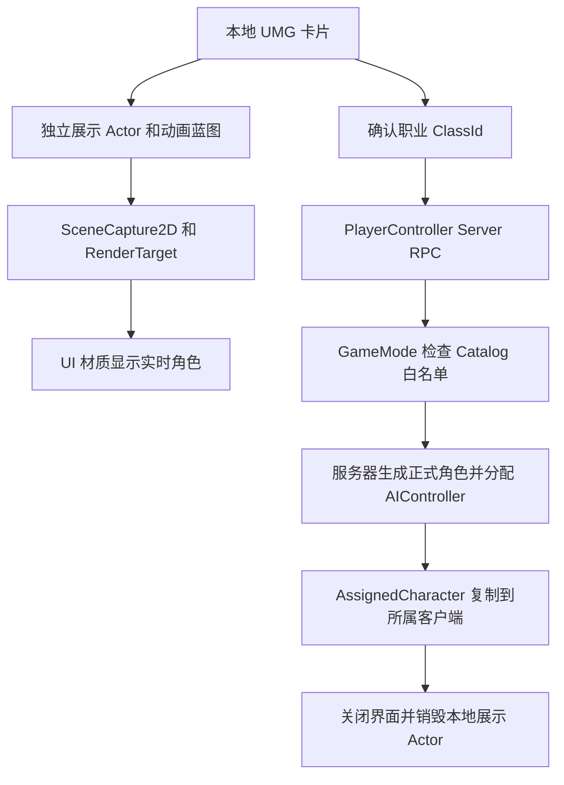

# 开局职业选择

TestMap 使用现有 GameMode，开局先创建 CameraPawn，玩家确认职业后才生成正式角色。2026-11-18 按参考图调整了三卡片界面。

## 玩家编号

- 监听服务器的主机固定为 1P，加入的玩家为 2P，单人模式为 1P。
- GameMode 在玩家进入时把编号写入 PlayerController。编号到达本地后才打开选人界面，右上角显示对应徽牌。
- 确认职业时，服务器按已分配的编号选择对应的 `WarriorSpawn`，将同一个编号复制到正式角色。每位玩家可以分别确认进入。

## 编辑入口

- `/Game/BoldersDemo/Blueprints/UI/ClassSelection/WBP_ClassSelection`：主界面布局。
- 同目录 `WBP_ClassCard`：三个职业共用的卡片；`BP_CharacterPreview`：独立展示 Actor，可调整 Capture 镜头。
- `/Game/BoldersDemo/Assets/UI/ClassSelection/DA_ClassSelectionCatalog`：职业顺序、允许生成的职业、界面材质和普通、选中两种卡片贴图。
- `/Game/BoldersDemo/Assets/UI/ClassSelection/Style`：卡片底图、带字按钮与徽牌、文字图集和标题装饰。
- 同目录 `DA_Class_Warrior`、`DA_Class_Archer`、`DA_Class_Mage`：职业名字、说明、正式角色类、展示模型、武器、石台、动作与动画蓝图。
- `/Game/BoldersDemo/Blueprints/Characters/<职业>/Preview/ABP_Preview_<职业>`：三个展示动作的混合。
- `/Game/BoldersDemo/Assets/Characters/<职业>/Animations/Preview`：展示动作副本。

展示角色继承 Actor，不继承 BaseCharacter，没有 ASC、AIController、寻路或攻击逻辑。正式角色仍使用原来的职业蓝图。弓弦仅作展示，不生成箭矢。

## 动作

| 职业 | A 常态循环 | B 鼠标悬停 | C 选中 |
| --- | --- | --- | --- |
| 战士 | GeneralIdle_A | Melee_Block | Cheering |
| 弓箭手 | Bow_Idle | Bow_Draw | Waving |
| 法师 | GeneralIdle_A | Magic_Spellcasting | Magic_Summon |

B、C 播放一次，然后平滑回到 A。选中标记不随动作结束而消失。选中优先于悬停；取消选择恢复未选中状态。动画蓝图使用 Blend Poses by Int，切换约 0.25 秒，重新进入动作时重置播放时间。

初始动作节点由编辑器命令 `Bolders.BuildClassSelection` 创建。已有动画图不会被这个命令覆盖；以后换动作时，应同时更新 Data Asset 的动画引用及对应 ABP 的 Sequence Player，保证播放长度和实际动画一致。

## 数据流与网络

客户端只提交 ClassId，不提交任意角色类或路径。服务器拒绝不在 Catalog 中的职业，已分配角色后也不会重复生成。两位玩家可以选相同职业。当前玩家槽位按确认顺序分配，最多使用地图已有的出生点。

预览 Actor、RenderTarget、动态材质都由本地界面创建并持有 UPROPERTY 引用。退出界面销毁 Actor，关闭 Capture；没有预览网络复制。选择阶段 UIOnly 输入，HUD 隐藏；确认成功恢复 GameAndUI。

## 美术来源与生成

界面使用 GPT Image 成品贴图。按钮和徽牌的底板与文字在同一张图上，选人标题、等待和失败提示也使用带字贴图。每张卡片的中文职业名与下方英文名绘制在同一张贴图上。卡片底图保留金框和青色选中光晕。UMG 使用 UV 取用图集中的部件，处理输入和状态切换，卡片里的角色继续实时渲染。源图与提示词见 `ArtSources/UI/ClassSelection/Style/LetteredArtwork.md`。

石台引用 Inferno_World_Free 的 SM_Stone_001，人物动作取自项目已有角色和 KayKit。只更新选人外观时，在 Unreal 启用 Python Editor Script 后运行 `Scripts/Editor/update_class_selection_style.py`。该脚本导入新美术、更新职业目录和预览镜头，再调用 `Bolders.LayoutClassSelection` 刷新现有两个 UMG 蓝图。完整初始化继续使用 `Scripts/Editor/setup_class_selection.py`。

## 初版验证记录

- Development Editor C++ 编译通过；两个 UMG 蓝图编译通过。
- 重启编辑器后进行了双人 PIE；检查中文字体、三个实时模型、石台和武器构图。
- 实际鼠标操作确认弓箭手、法师后进入 TestMap；主机通过相同 Widget 事件选择战士。
- 客户端选择法师时，主机仍保持未选择；选中动作结束后 PoseIndex 返回待机而选择保持。
- 无效 ClassId 被拒绝并显示失败信息；取消选择可重选；角色已分配后重复提交不增加角色。
- 双方确认后，两端都存在法师和战士，预览 Actor 数量均为零，选择 Widget 已移除。
- 全屏双人 PIE 出现显存预算超出提示；未进行性能定标或 Cook/打包验证。

## 三卡片上版验证

- UE 5.9 Development Editor 编译通过，导入美术并更新两个界面蓝图时报告 0 错误、0 警告。
- 在 1600 × 900 的实际游戏画面检查了未选中、选中弓箭手、选中法师。核对了中文字体、卡片边框和状态切换，三个角色的帽子、武器与石台均可见。
- 双人 PIE 验证了各自选择和取消、无效职业被拒绝、客户端先确认法师、主机后确认战士。两端均收到两名正式角色，并清理选择界面和预览 Actor。
