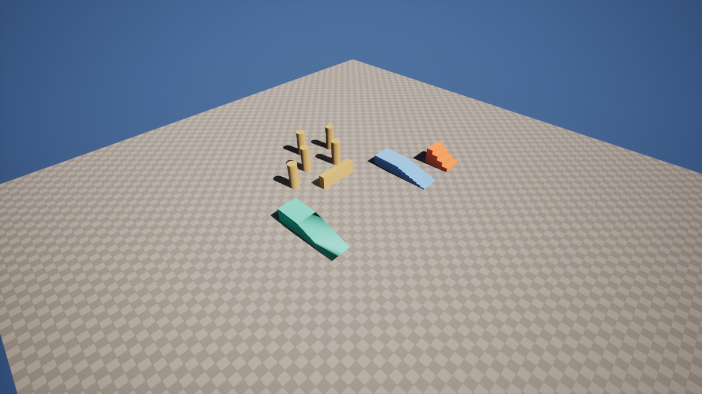
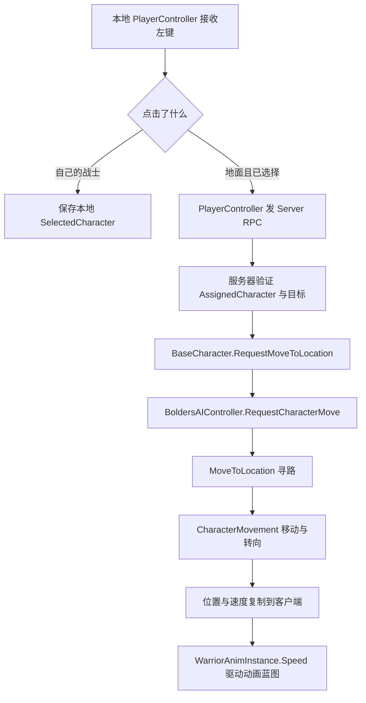

# 战士点击移动与联机代码讲解

本轮完成每人一个战士的主机联机原型：左键选中自己的战士，再左键点地面移动。玩家仍控制 CameraPawn；战士由服务器的 AIController 控制。移动结果复制到客户端，动画根据各端角色的速度播放。

## 在 TestMap 中体验

单人直接 Play。双人测试在 Play 的多人选项中设置 Listen Server、2 名玩家；每个玩家先点击自己的战士，再点击地面。点另一名玩家的战士不会切换选择，也不会发出移动命令。WASD、QE、滚轮继续控制本地镜头。

| 测试物 | 规格与用途 |
| --- | --- |
| 绿色斜坡及平台 | 长 600 cm、宽 300 cm、高 200 cm，坡度约 18.4°，测试上坡与下坡 |
| 蓝色台阶及平台 | 8 级，每级 20 cm 高、70 cm 深，测试连续跨步 |
| 橙色高台阶 | 4 级，每级 65 cm 高，测试超出跨步能力时拒绝移动 |
| 黄色柱阵 | 5 根半径 70 cm、高 400 cm 的柱子，测试绕行 |
| 黄色墙 | 100 × 600 × 200 cm，测试新路径与绕障 |

新静态网格体在 `/Game/BoldersDemo/Assets/Environment/MovementTest/Meshes`，材质在同级 `Materials`。所有测试物都位于 TestMap 大纲的 `MovementTest` 文件夹。地面、斜坡、正常台阶和平台带有 `WalkableGround` Actor Tag；柱子和墙不带此标记。



## 先理解调用关系



`Possess` 与“命令某个战士”是两件事。PlayerController Possess CameraPawn；AIController Possess WarriorCharacter。鼠标命令沿着上图传递，不会更换玩家正在控制的 Pawn。

## 两个角色引用的区别

`SelectedCharacter` 是本地弱引用，表示鼠标当前选中的角色。它不负责让角色存活，每次使用都检查 `IsValid()`；角色被销毁后不能继续拿它发指令。

`AssignedCharacter` 是服务器为该 PlayerController 分配的角色，复制给所属客户端。服务器收到请求后要求 `TargetCharacter == AssignedCharacter`，因此客户端不能通过更改选中指针来指挥别人的角色。

`UPROPERTY` 让这些字段参与 UE 的反射及相关对象引用处理。`Transient` 排除普通持久化；`ReplicatedUsing` 和 `GetLifetimeReplicatedProps` 才是这里配置网络复制的部分。弱引用与强引用也不取决于 `Transient`。

## 为什么把逻辑放在这些类里

- **PlayerController**：处理玩家意图、鼠标检测和网络请求。RPC 放在玩家拥有的 PlayerController 上，避免在客户端不拥有的 AI 角色上发送服务器 RPC。
- **BaseCharacter**：定义角色共用的移动入口和默认移动设置。Mesh、Capsule、CharacterMovement 已经由 ACharacter 提供，不再重复创建。
- **WarriorCharacter**：保留具体战士类型。目前没有战士独有规则，所以空子类是正常状态。具体模型、动画和胶囊尺寸由 BP_Warrior 配置。
- **AIController**：提交寻路请求，处理完成、失败或取消。`MoveToLocation` 返回受理结果，`OnMoveCompleted` 才报告最终结果。当前没有自主决策需求，因此不加入行为树。
- **GameMode**：仅服务器创建并分配战士。出生点使用带 `WarriorSpawn` Tag 的 TargetPoint；玩家退出时清理角色及 AIController。
- **WarriorAnimInstance**：在游戏线程读取 Pawn 的水平速度，动画蓝图用这个值驱动 Idle/Walk/Run 混合空间，不额外复制动画状态。

## 高低差与镜头

角色使用 CharacterMovement 和 NavMesh，能够沿斜坡与允许高度的台阶移动。服务器的短距离竖直射线用于验证点击目的地，再投射到导航网格；完整路径由 AIController 查找，部分路径被拒绝。

这条射线不用于调整相机高度。CameraPawn 仍是本地 FloatingPawnMovement 自由镜头，保持既有高度；移动角色不会强制相机跟随或升降。`bIsFollowing` 保留，跟随功能尚未实现。

本轮小地图使用角色 Always Relevant，避免服务器上静止的镜头位置影响角色可见性。它适合当前原型，大地图应另行设计网络相关性范围。相机 Actor 保留生成和控制关系所需的复制，但不复制相机移动。

## 蓝图配置

- `BP_Warrior`：父类 WarriorCharacter，模型来自 `Assets/Characters/Warrior/SK_Warrior`，缩放 0.7，Mesh 相对 Z 为 -90，Yaw 为 -90；胶囊半径 38、高度一半 90。由 BoldersAIController 自动控制，不自动交给玩家。
- `ABP_Warrior`：父类 WarriorAnimInstance；Speed 连接到 `BS_Warrior_Locomotion` 的 X 输入，再连接最终姿态。
- `BS_Warrior_Locomotion`：0/150/300 cm/s 分别对应现有待机、走路、跑步动画。实际位移来自 CharacterMovement。
- `BP_BoldersPlayerController`：配置 `IA_CommandClick` 和 `IMC_Command`，与原相机输入上下文并存。
- `BP_BoldersGameMode`：父类 BoldersGameMode，WarriorClass 为 BP_Warrior，DefaultPawnClass 仍为 BP_CameraPawn。

## 验证范围

编辑器双人 Listen Server 验证了客户端绕障、上下坡、上下台阶、拒绝高台阶目标及拒绝其他玩家角色的命令。到达后主机与客户端位置差小于 0.01 cm（本机同进程 PIE 测量，不代表互联网延迟表现）。

真实客户端窗口的左键选中和点击移动已操作验证。新命令能够取消旧路径。客户端镜头移动约 1174 cm 时，服务器对应镜头位置变化为 0。客户端断开后，主机剩余 1 个战士和 1 个 AIController。测试数据见 `Characters/Warrior/Validation/results.json`。

双窗口运行期间出现过显存预算提示；功能测试通过不等于性能验收。本轮未做丢包、延迟模拟、独立服务器或打包验证，也未实现大厅、复活或重连。

## 代码阅读顺序

建议先读 PlayerController 的 `HandleCommandClick` 和服务器实现，再读 BaseCharacter 与 AIController。最后再看 GameMode 的生成清理和 `GetLifetimeReplicatedProps`。下面按这个顺序列出本轮核心源码；编辑器生成资产的辅助代码不属于游戏运行逻辑。

### BoldersPlayerController.h

文件：`Source/BoldersDemo/Public/Player/BoldersPlayerController.h`

```cpp
#pragma once

#include "CoreMinimal.h"
#include "GameFramework/PlayerController.h"
#include "BoldersPlayerController.generated.h"

class ABaseCharacter;
class UInputAction;
class UInputMappingContext;
class ULocalPlayer;
UCLASS()
class BOLDERSDEMO_API ABoldersPlayerController : public APlayerController
{
	GENERATED_BODY()
public:
	virtual void GetLifetimeReplicatedProps(TArray<FLifetimeProperty>& OutLifetimeProps) const override;
	void AssignCharacter(ABaseCharacter* TargetCharacter);
	ABaseCharacter* GetAssignedCharacter() const { return AssignedCharacter; }
protected:
	virtual void BeginPlay() override;
	virtual void EndPlay(const EEndPlayReason::Type Reason) override;
	virtual void SetupInputComponent() override;
	void HandleCommandClick();
	UFUNCTION(Server, Reliable)
	void ServerRequestMove(ABaseCharacter* TargetCharacter, FVector_NetQuantize Destination);
	UFUNCTION()
	void OnRep_AssignedCharacter();

	UPROPERTY(EditDefaultsOnly, Category="Input")
	TObjectPtr<UInputMappingContext> CameraMappingContext;
	UPROPERTY(EditDefaultsOnly, Category="Input")
	TObjectPtr<UInputMappingContext> CommandMappingContext;
	UPROPERTY(EditDefaultsOnly, Category="Input")
	TObjectPtr<UInputAction> CommandClickAction;
	// Server authorization record; deliberately separate from Actor::Owner.
	UPROPERTY(Transient, ReplicatedUsing=OnRep_AssignedCharacter, BlueprintReadOnly, Category="Character")
	TObjectPtr<ABaseCharacter> AssignedCharacter;
	UPROPERTY(Transient)
	TWeakObjectPtr<ABaseCharacter> SelectedCharacter;
private:
	TWeakObjectPtr<ULocalPlayer> MappingLocalPlayer;
	double LastMoveRequestTime = -1.0;
};
```

### BoldersPlayerController.cpp

文件：`Source/BoldersDemo/Private/Player/BoldersPlayerController.cpp`

```cpp
#include "Player/BoldersPlayerController.h"
#include "Characters/BaseCharacter.h"
#include "EnhancedInputComponent.h"
#include "EnhancedInputSubsystems.h"
#include "Engine/LocalPlayer.h"
#include "Engine/World.h"
#include "GameFramework/CharacterMovementComponent.h"
#include "InputMappingContext.h"
#include "NavigationSystem.h"
#include "Net/UnrealNetwork.h"

void ABoldersPlayerController::BeginPlay()
{
	Super::BeginPlay();
	if (!IsLocalController()) return;
	bShowMouseCursor = true;
	FInputModeGameAndUI Mode;
	Mode.SetHideCursorDuringCapture(false);
	Mode.SetLockMouseToViewportBehavior(EMouseLockMode::DoNotLock);
	SetInputMode(Mode);
	if (ULocalPlayer* LocalPlayer = GetLocalPlayer())
	{
		if (auto* Subsystem = LocalPlayer->GetSubsystem<UEnhancedInputLocalPlayerSubsystem>())
		{
			if (CameraMappingContext) Subsystem->AddMappingContext(CameraMappingContext, 0);
			if (CommandMappingContext) Subsystem->AddMappingContext(CommandMappingContext, 1);
			MappingLocalPlayer = LocalPlayer;
		}
	}
}

void ABoldersPlayerController::EndPlay(const EEndPlayReason::Type Reason)
{
	if (ULocalPlayer* LocalPlayer = MappingLocalPlayer.Get())
	{
		if (auto* Subsystem = LocalPlayer->GetSubsystem<UEnhancedInputLocalPlayerSubsystem>())
		{
			if (CameraMappingContext) Subsystem->RemoveMappingContext(CameraMappingContext);
			if (CommandMappingContext) Subsystem->RemoveMappingContext(CommandMappingContext);
		}
	}
	MappingLocalPlayer.Reset();
	SelectedCharacter.Reset();
	Super::EndPlay(Reason);
}

void ABoldersPlayerController::SetupInputComponent()
{
	Super::SetupInputComponent();
	if (auto* Input = Cast<UEnhancedInputComponent>(InputComponent))
	{
		if (CommandClickAction)
			Input->BindAction(CommandClickAction, ETriggerEvent::Started, this, &ThisClass::HandleCommandClick);
	}
}

void ABoldersPlayerController::HandleCommandClick()
{
	if (!IsLocalController()) return;
	FHitResult Hit;
	if (!GetHitResultUnderCursorByChannel(UEngineTypes::ConvertToTraceType(ECC_Visibility), false, Hit)) return;
	if (ABaseCharacter* TargetCharacter = Cast<ABaseCharacter>(Hit.GetActor()))
	{
		if (TargetCharacter == AssignedCharacter && IsValid(TargetCharacter))
		{
			SelectedCharacter = TargetCharacter;
			UE_LOG(LogTemp, Log, TEXT("WarriorSelection: %s selected %s"), *GetName(), *TargetCharacter->GetName());
		}
		return;
	}
	if (SelectedCharacter.IsValid() && IsValid(Hit.GetActor()) && Hit.GetActor()->ActorHasTag(TEXT("WalkableGround")))
		ServerRequestMove(SelectedCharacter.Get(), Hit.ImpactPoint);
}

void ABoldersPlayerController::ServerRequestMove_Implementation(ABaseCharacter* TargetCharacter, FVector_NetQuantize Destination)
{
	if (!IsValid(TargetCharacter) || TargetCharacter != AssignedCharacter || Destination.ContainsNaN()) return;
	const double Now = GetWorld()->GetTimeSeconds();
	if (Now - LastMoveRequestTime < 0.05) return;
	LastMoveRequestTime = Now;
	if (Destination.GetAbsMax() > 100000.f) return;
	FHitResult Ground;
	FCollisionQueryParams Params(SCENE_QUERY_STAT(WarriorMoveGround), false, TargetCharacter);
	const FVector Target = Destination;
	if (!GetWorld()->LineTraceSingleByChannel(Ground, Target + FVector(0,0,100),
		Target - FVector(0,0,100), ECC_Visibility, Params)) return;
	if (!IsValid(Ground.GetActor()) || !Ground.GetActor()->ActorHasTag(TEXT("WalkableGround"))
		|| Ground.ImpactNormal.Z < TargetCharacter->GetCharacterMovement()->GetWalkableFloorZ()) return;
	auto* Nav = FNavigationSystem::GetCurrent<UNavigationSystemV1>(GetWorld());
	FNavLocation NavTarget;
	if (!Nav || !Nav->ProjectPointToNavigation(Ground.ImpactPoint, NavTarget, FVector(50,50,100))) return;
	TargetCharacter->RequestMoveToLocation(NavTarget.Location);
}

void ABoldersPlayerController::AssignCharacter(ABaseCharacter* TargetCharacter)
{
	if (!HasAuthority()) return;
	AssignedCharacter = TargetCharacter;
	OnRep_AssignedCharacter();
	ForceNetUpdate();
}

void ABoldersPlayerController::OnRep_AssignedCharacter()
{
	SelectedCharacter.Reset();
}

void ABoldersPlayerController::GetLifetimeReplicatedProps(TArray<FLifetimeProperty>& OutLifetimeProps) const
{
	Super::GetLifetimeReplicatedProps(OutLifetimeProps);
	DOREPLIFETIME_CONDITION(ABoldersPlayerController, AssignedCharacter, COND_OwnerOnly);
}
```

### BaseCharacter.h

文件：`Source/BoldersDemo/Public/Characters/BaseCharacter.h`

```cpp
#pragma once

#include "CoreMinimal.h"
#include "GameFramework/Character.h"
#include "BaseCharacter.generated.h"

class UKayKitEquipmentComponent;
UCLASS()
class BOLDERSDEMO_API ABaseCharacter : public ACharacter
{
	GENERATED_BODY()
public:
	ABaseCharacter();
	// Accepted does not mean arrived. Only the server may execute this request.
	UFUNCTION(BlueprintCallable, BlueprintAuthorityOnly, Category="Character|Movement")
	bool RequestMoveToLocation(const FVector& Destination);

	UPROPERTY(VisibleAnywhere, BlueprintReadOnly, Category="Character|Equipment")
	TObjectPtr<UKayKitEquipmentComponent> KayKitEquipment;
};
```

### BaseCharacter.cpp

文件：`Source/BoldersDemo/Private/Characters/BaseCharacter.cpp`

```cpp
#include "Characters/BaseCharacter.h"
#include "AI/BoldersAIController.h"
#include "Characters/KayKitEquipmentComponent.h"
#include "Components/CapsuleComponent.h"
#include "Components/SkeletalMeshComponent.h"
#include "GameFramework/CharacterMovementComponent.h"

ABaseCharacter::ABaseCharacter()
{
	PrimaryActorTick.bCanEverTick = false;
	bReplicates = true;
	SetReplicateMovement(true);
	// Small demo arena: relevance must not depend on the stationary server camera.
	bAlwaysRelevant = true;
	AIControllerClass = ABoldersAIController::StaticClass();
	AutoPossessAI = EAutoPossessAI::PlacedInWorldOrSpawned;
	AutoPossessPlayer = EAutoReceiveInput::Disabled;
	bUseControllerRotationYaw = false;
	GetCharacterMovement()->bOrientRotationToMovement = true;
	GetCharacterMovement()->RotationRate = FRotator(0.f, 540.f, 0.f);
	GetCharacterMovement()->MaxWalkSpeed = 300.f;
	GetCharacterMovement()->bUseRVOAvoidance = true;
	GetCapsuleComponent()->SetCollisionResponseToChannel(ECC_Visibility, ECR_Block);
	GetCapsuleComponent()->SetCanEverAffectNavigation(false);
	GetMesh()->SetCollisionEnabled(ECollisionEnabled::NoCollision);
	GetMesh()->SetCanEverAffectNavigation(false);
	KayKitEquipment = CreateDefaultSubobject<UKayKitEquipmentComponent>(TEXT("KayKitEquipment"));
}

bool ABaseCharacter::RequestMoveToLocation(const FVector& Destination)
{
	if (!HasAuthority() || Destination.ContainsNaN()) return false;
	ABoldersAIController* AI = Cast<ABoldersAIController>(GetController());
	return AI && AI->RequestCharacterMove(Destination);
}
```

### BoldersAIController.h

文件：`Source/BoldersDemo/Public/AI/BoldersAIController.h`

```cpp
#pragma once

#include "CoreMinimal.h"
#include "AIController.h"
#include "BoldersAIController.generated.h"

UCLASS()
class BOLDERSDEMO_API ABoldersAIController : public AAIController
{
	GENERATED_BODY()
public:
	bool RequestCharacterMove(const FVector& Destination);
protected:
	virtual void OnMoveCompleted(FAIRequestID RequestID, const FPathFollowingResult& Result) override;
	UPROPERTY(EditDefaultsOnly, Category="Movement", meta=(ClampMin="0.0"))
	float AcceptanceRadius = 50.f;
};
```

### BoldersAIController.cpp

文件：`Source/BoldersDemo/Private/AI/BoldersAIController.cpp`

```cpp
#include "AI/BoldersAIController.h"
#include "Navigation/PathFollowingComponent.h"

bool ABoldersAIController::RequestCharacterMove(const FVector& Destination)
{
	if (!HasAuthority() || !GetPawn() || Destination.ContainsNaN()) return false;
	const auto Result = MoveToLocation(Destination, AcceptanceRadius, false, true, false, false, nullptr, false);
	UE_LOG(LogTemp, Log, TEXT("WarriorMove: %s request=%d destination=%s"),
		*GetNameSafe(GetPawn()), static_cast<int32>(Result), *Destination.ToCompactString());
	return Result != EPathFollowingRequestResult::Failed;
}

void ABoldersAIController::OnMoveCompleted(FAIRequestID RequestID, const FPathFollowingResult& Result)
{
	Super::OnMoveCompleted(RequestID, Result);
	UE_LOG(LogTemp, Log, TEXT("WarriorMove: %s completed=%s"), *GetNameSafe(GetPawn()), *Result.ToString());
}
```

### WarriorCharacter.h

文件：`Source/BoldersDemo/Public/Characters/Roles/WarriorCharacter.h`

```cpp
#pragma once

#include "CoreMinimal.h"
#include "Characters/BaseCharacter.h"
#include "WarriorCharacter.generated.h"

UCLASS()
class BOLDERSDEMO_API AWarriorCharacter : public ABaseCharacter
{
	GENERATED_BODY()
};
```

### WarriorCharacter.cpp

文件：`Source/BoldersDemo/Private/Characters/Roles/WarriorCharacter.cpp`

```cpp
#include "Characters/WarriorCharacter.h"
```

### BoldersGameMode.h

文件：`Source/BoldersDemo/Public/Game/BoldersGameMode.h`

```cpp
#pragma once

#include "CoreMinimal.h"
#include "GameFramework/GameModeBase.h"
#include "BoldersGameMode.generated.h"

class AWarriorCharacter;
UCLASS()
class BOLDERSDEMO_API ABoldersGameMode : public AGameModeBase
{
	GENERATED_BODY()
public:
	virtual void HandleStartingNewPlayer_Implementation(APlayerController* NewPlayer) override;
	virtual void Logout(AController* Exiting) override;
protected:
	UPROPERTY(EditDefaultsOnly, Category="Characters")
	TSubclassOf<AWarriorCharacter> WarriorClass;
private:
	TMap<TWeakObjectPtr<AController>, TWeakObjectPtr<AActor>> OccupiedStarts;
};
```

### BoldersGameMode.cpp

文件：`Source/BoldersDemo/Private/Game/BoldersGameMode.cpp`

```cpp
#include "Game/BoldersGameMode.h"
#include "AIController.h"
#include "Characters/WarriorCharacter.h"
#include "EngineUtils.h"
#include "Engine/TargetPoint.h"
#include "Player/BoldersPlayerController.h"

void ABoldersGameMode::HandleStartingNewPlayer_Implementation(APlayerController* NewPlayer)
{
	Super::HandleStartingNewPlayer_Implementation(NewPlayer);
	auto* PC = Cast<ABoldersPlayerController>(NewPlayer);
	if (!PC || IsValid(PC->GetAssignedCharacter())) return;
	if (!WarriorClass)
	{
		UE_LOG(LogTemp, Error, TEXT("WarriorSpawn: WarriorClass is not configured."));
		return;
	}
	TArray<ATargetPoint*> Starts;
	for (TActorIterator<ATargetPoint> It(GetWorld()); It; ++It)
		if (It->ActorHasTag(TEXT("WarriorSpawn"))) Starts.Add(*It);
	Starts.Sort([](const ATargetPoint& A, const ATargetPoint& B) { return A.GetName() < B.GetName(); });
	for (ATargetPoint* Start : Starts)
	{
		bool bOccupied = false;
		for (const auto& Pair : OccupiedStarts)
			if (Pair.Key.IsValid() && Pair.Value == Start) { bOccupied = true; break; }
		if (bOccupied) continue;
		FActorSpawnParameters Params;
		Params.SpawnCollisionHandlingOverride = ESpawnActorCollisionHandlingMethod::AdjustIfPossibleButDontSpawnIfColliding;
		auto* Warrior = GetWorld()->SpawnActor<AWarriorCharacter>(WarriorClass, Start->GetActorTransform(), Params);
		if (!Warrior) continue;
		PC->AssignCharacter(Warrior);
		OccupiedStarts.Add(PC, Start);
		UE_LOG(LogTemp, Log, TEXT("WarriorSpawn: %s assigned %s"), *PC->GetName(), *Warrior->GetName());
		return;
	}
	UE_LOG(LogTemp, Error, TEXT("WarriorSpawn: No available WarriorSpawn target point for %s."), *PC->GetName());
}

void ABoldersGameMode::Logout(AController* Exiting)
{
	if (auto* PC = Cast<ABoldersPlayerController>(Exiting))
	{
		if (ABaseCharacter* Character = PC->GetAssignedCharacter(); IsValid(Character))
		{
			auto* AI = Cast<AAIController>(Character->GetController());
			if (AI) { AI->StopMovement(); AI->UnPossess(); }
			Character->Destroy();
			if (AI) AI->Destroy();
		}
		PC->AssignCharacter(nullptr);
	}
	OccupiedStarts.Remove(Exiting);
	Super::Logout(Exiting);
}
```

### WarriorAnimInstance.h

文件：`Source/BoldersDemo/Public/Characters/Animation/WarriorAnimInstance.h`

```cpp
#pragma once

#include "CoreMinimal.h"
#include "Animation/AnimInstance.h"
#include "WarriorAnimInstance.generated.h"

UCLASS()
class BOLDERSDEMO_API UWarriorAnimInstance : public UAnimInstance
{
	GENERATED_BODY()
public:
	virtual void NativeUpdateAnimation(float DeltaSeconds) override;
	UPROPERTY(BlueprintReadOnly, Transient, Category="Movement")
	float Speed = 0.f;
};
```

### WarriorAnimInstance.cpp

文件：`Source/BoldersDemo/Private/Characters/Animation/WarriorAnimInstance.cpp`

```cpp
#include "Characters/WarriorAnimInstance.h"
#include "GameFramework/Pawn.h"
void UWarriorAnimInstance::NativeUpdateAnimation(float DeltaSeconds)
{
	Super::NativeUpdateAnimation(DeltaSeconds);
	const APawn* Pawn = TryGetPawnOwner();
	Speed = IsValid(Pawn) ? Pawn->GetVelocity().Size2D() : 0.f;
}
```

### CameraPawn.h

文件：`Source/BoldersDemo/Public/Camera/CameraPawn.h`

```cpp
#pragma once

#include "CoreMinimal.h"
#include "GameFramework/Pawn.h"
#include "CameraPawn.generated.h"

class UCameraComponent;
class UFloatingPawnMovement;
class UInputAction;
class USceneComponent;
class USpringArmComponent;
struct FInputActionValue;

UCLASS()
class BOLDERSDEMO_API ACameraPawn : public APawn
{
	GENERATED_BODY()

public:
	ACameraPawn();
	virtual void OnConstruction(const FTransform& Transform) override;

protected:
	virtual void SetupPlayerInputComponent(UInputComponent* PlayerInputComponent) override;

	void HandleCameraMove(const FInputActionValue& Value);
	void HandleCameraRotate(const FInputActionValue& Value);
	void HandleCameraZoom(const FInputActionValue& Value);

	UPROPERTY(VisibleAnywhere, BlueprintReadOnly, Category = "Camera")
	TObjectPtr<USceneComponent> CameraRoot;

	UPROPERTY(VisibleAnywhere, BlueprintReadOnly, Category = "Camera")
	TObjectPtr<USpringArmComponent> SpringArm;

	UPROPERTY(VisibleAnywhere, BlueprintReadOnly, Category = "Camera")
	TObjectPtr<UCameraComponent> Camera;

	UPROPERTY(VisibleAnywhere, BlueprintReadOnly, Category = "Camera")
	TObjectPtr<UFloatingPawnMovement> FloatingMovement;

	UPROPERTY(EditDefaultsOnly, Category = "Input")
	TObjectPtr<UInputAction> CameraMoveAction;

	UPROPERTY(EditDefaultsOnly, Category = "Input")
	TObjectPtr<UInputAction> CameraRotateAction;

	UPROPERTY(EditDefaultsOnly, Category = "Input")
	TObjectPtr<UInputAction> CameraZoomAction;

	UPROPERTY(EditDefaultsOnly, Category = "Camera|Rotation", meta = (ClampMin = "0.0"))
	float RotationSpeed = 90.0f;

	// Downward angle from the horizontal ground plane, in degrees.
	UPROPERTY(EditDefaultsOnly, BlueprintReadOnly, Category = "Camera|Rotation", meta = (ClampMin = "0.0", ClampMax = "90.0", UIMin = "0.0", UIMax = "90.0", Units = "Degrees"))
	float CameraGroundAngle = 50.0f;

	UPROPERTY(EditDefaultsOnly, Category = "Camera|Zoom", meta = (ClampMin = "0.0"))
	float ZoomStep = 150.0f;

	UPROPERTY(EditDefaultsOnly, Category = "Camera|Zoom", meta = (ClampMin = "0.0"))
	float MinArmLength = 500.0f;

	UPROPERTY(EditDefaultsOnly, Category = "Camera|Zoom", meta = (ClampMin = "0.0"))
	float MaxArmLength = 2000.0f;

private:
	// Reserved for a future follow mode; free camera movement is currently always active.
	bool bIsFollowing = false;
};
```

### CameraPawn.cpp

文件：`Source/BoldersDemo/Private/Camera/CameraPawn.cpp`

```cpp
#include "Camera/CameraPawn.h"

#include "Camera/CameraComponent.h"
#include "Components/SceneComponent.h"
#include "EnhancedInputComponent.h"
#include "Engine/World.h"
#include "GameFramework/FloatingPawnMovement.h"
#include "GameFramework/SpringArmComponent.h"
#include "InputAction.h"
#include "InputActionValue.h"

ACameraPawn::ACameraPawn()
{
	PrimaryActorTick.bCanEverTick = false;
	bReplicates = true;
	bOnlyRelevantToOwner = true;
	SetReplicateMovement(false);
	bUseControllerRotationPitch = false;
	bUseControllerRotationYaw = false;
	bUseControllerRotationRoll = false;

	CameraRoot = CreateDefaultSubobject<USceneComponent>(TEXT("CameraRoot"));
	SetRootComponent(CameraRoot);

	SpringArm = CreateDefaultSubobject<USpringArmComponent>(TEXT("SpringArm"));
	SpringArm->SetupAttachment(CameraRoot);
	SpringArm->TargetArmLength = 1200.0f;
	SpringArm->SetRelativeRotation(FRotator(-CameraGroundAngle, 0.0f, 0.0f));
	SpringArm->bUsePawnControlRotation = false;
	SpringArm->bDoCollisionTest = false;
	SpringArm->bEnableCameraLag = false;
	SpringArm->bEnableCameraRotationLag = false;

	Camera = CreateDefaultSubobject<UCameraComponent>(TEXT("Camera"));
	Camera->SetupAttachment(SpringArm, USpringArmComponent::SocketName);
	Camera->bUsePawnControlRotation = false;

	FloatingMovement = CreateDefaultSubobject<UFloatingPawnMovement>(TEXT("FloatingMovement"));
	FloatingMovement->MaxSpeed = 1200.0f;
	FloatingMovement->Acceleration = 8000.0f;
	FloatingMovement->Deceleration = 8000.0f;
}

void ACameraPawn::OnConstruction(const FTransform& Transform)
{
	Super::OnConstruction(Transform);

	FRotator Rotation = SpringArm->GetRelativeRotation();
	Rotation.Pitch = -FMath::Clamp(CameraGroundAngle, 0.0f, 90.0f);
	SpringArm->SetRelativeRotation(Rotation);
}

void ACameraPawn::SetupPlayerInputComponent(UInputComponent* PlayerInputComponent)
{
	Super::SetupPlayerInputComponent(PlayerInputComponent);

	UEnhancedInputComponent* EnhancedInput = Cast<UEnhancedInputComponent>(PlayerInputComponent);
	if (!EnhancedInput)
	{
		UE_LOG(LogTemp, Warning, TEXT("CameraPawn: EnhancedInputComponent is unavailable."));
		return;
	}

	if (CameraMoveAction)
	{
		EnhancedInput->BindAction(CameraMoveAction, ETriggerEvent::Triggered, this, &ACameraPawn::HandleCameraMove);
	}
	if (CameraRotateAction)
	{
		EnhancedInput->BindAction(CameraRotateAction, ETriggerEvent::Triggered, this, &ACameraPawn::HandleCameraRotate);
	}
	if (CameraZoomAction)
	{
		EnhancedInput->BindAction(CameraZoomAction, ETriggerEvent::Triggered, this, &ACameraPawn::HandleCameraZoom);
	}
	if (!CameraMoveAction || !CameraRotateAction || !CameraZoomAction)
	{
		UE_LOG(LogTemp, Warning, TEXT("CameraPawn: One or more camera input actions are not assigned."));
	}
}

void ACameraPawn::HandleCameraMove(const FInputActionValue& Value)
{
	if (!IsLocallyControlled()) return;
	const FVector2D MoveInput = Value.Get<FVector2D>();
	const FRotator YawRotation(0.0f, SpringArm->GetComponentRotation().Yaw, 0.0f);
	const FVector Forward = FRotationMatrix(YawRotation).GetUnitAxis(EAxis::X);
	const FVector Right = FRotationMatrix(YawRotation).GetUnitAxis(EAxis::Y);

	AddMovementInput(Forward, MoveInput.Y);
	AddMovementInput(Right, MoveInput.X);
}

void ACameraPawn::HandleCameraRotate(const FInputActionValue& Value)
{
	if (!IsLocallyControlled()) return;
	const float YawDelta = Value.Get<float>() * RotationSpeed * GetWorld()->GetDeltaSeconds();
	FRotator Rotation = SpringArm->GetRelativeRotation();
	Rotation.Yaw += YawDelta;
	SpringArm->SetRelativeRotation(Rotation);
}

void ACameraPawn::HandleCameraZoom(const FInputActionValue& Value)
{
	if (!IsLocallyControlled()) return;
	const float NewLength = SpringArm->TargetArmLength - Value.Get<float>() * ZoomStep;
	SpringArm->TargetArmLength = FMath::Clamp(NewLength, MinArmLength, FMath::Max(MinArmLength, MaxArmLength));
}
```

### BoldersDemo.Build.cs

文件：`Source/BoldersDemo/BoldersDemo.Build.cs`

```csharp
// Copyright Epic Games, Inc. All Rights Reserved.

using UnrealBuildTool;

public class BoldersDemo : ModuleRules
{
	public BoldersDemo(ReadOnlyTargetRules Target) : base(Target)
	{
		PCHUsage = PCHUsageMode.UseExplicitOrSharedPCHs;
	
		PublicDependencyModuleNames.AddRange(new string[] { "Core", "CoreUObject", "Engine", "InputCore", "EnhancedInput", "AIModule" });

		PrivateDependencyModuleNames.AddRange(new string[] { "NavigationSystem" });
		if (Target.bBuildEditor)
		{
			PrivateDependencyModuleNames.AddRange(new string[] { "UnrealEd", "AnimGraph", "AnimGraphRuntime", "BlueprintGraph", "AssetTools", "EditorScriptingUtilities" });
		}

		// Uncomment if you are using Slate UI
		// PrivateDependencyModuleNames.AddRange(new string[] { "Slate", "SlateCore" });
		
		// Uncomment if you are using online features
		// PrivateDependencyModuleNames.Add("OnlineSubsystem");

		// To include OnlineSubsystemSteam, add it to the plugins section in your uproject file with the Enabled attribute set to true
	}
}
```
